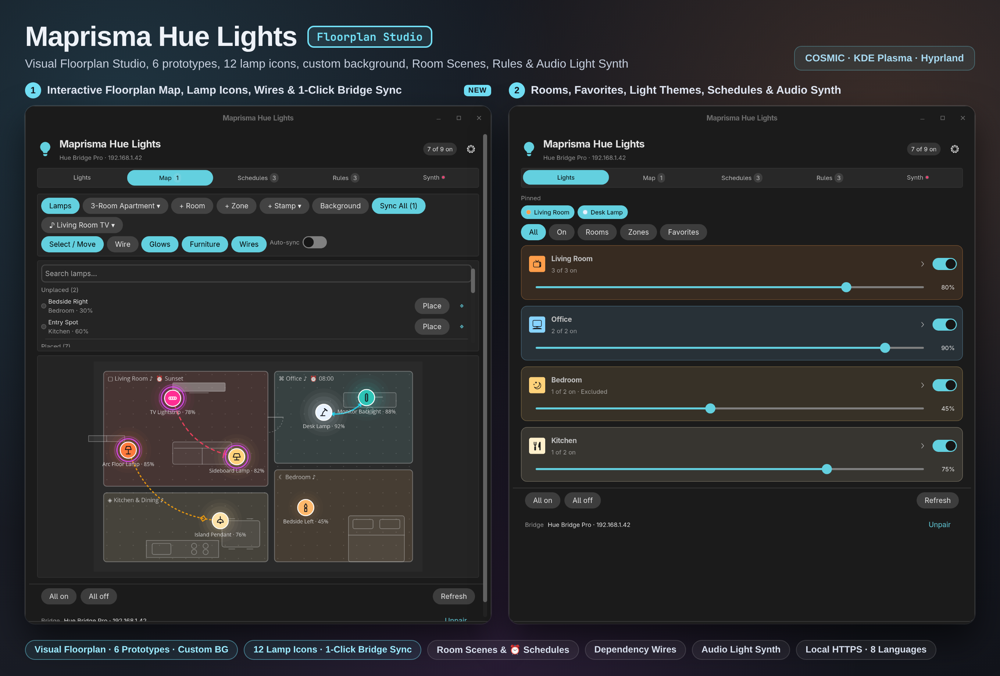

# Maprisma Hue Lights

A native Linux desktop & panel app (Rust/libcosmic) for **Philips Hue** on **COSMIC**, **KDE Plasma**, and **Hyprland**. Design an interactive **Visual Floorplan & Spatial Light Studio** for your home, control rooms, zones, individual lights, color, Kelvin warmth, native CLIP v2 effects, per-lamp Light Themes, Bridge or local schedules, linked-light rules, and a real-time Audio-Reactive Light Synthesizer — directly over your local Hue Bridge with pinned HTTPS and zero cloud account.



## Highlights

- **Visual Floorplan & Spatial Light Studio (`Map` tab):** Place lamps freely from a searchable **Unplaced / Placed** sidebar onto an interactive 2D home canvas with live color halos. Start from **6 editable house/apartment prototypes** (*Auto from Hue Bridge, Studio / Loft, 1-Bedroom Apartment, 3-Room Apartment, Family House + Terrace, Desk & Gaming Studio*) with draggable, 90°-rotatable architectural furniture stamps (*Door, Window, Sofa, TV, Desk, Bed, Dining, Kitchen*) — or import an optional **custom floorplan background image** (PNG/JPG/WebP via native XDG Desktop Portal picker, with opacity & contain/cover controls). Pick from **12 custom vector lamp icons**, rename lamps inline, surround lamps with **resizable Room & Zone boxes**, trigger or save **Room Scenes**, schedule scenes in 1 click (**⏰ Schedule scene**), draw **typed Bezier dependency wires** (Solid Cyan *Follow/Mirror*, Dashed Coral *Exclusive*, Dotted Amber *Companion*, Magenta *Synth* halo), and push all changes + Entertainment Area 2D/3D positions to your Hue Bridge via **1-click Sync All** or **Auto-sync**.
- **Lights, Rooms & Scenes:** One card per room and zone with Hue archetype icons, live CLIP v2 Server-Sent Events (`/eventstream/clip/v2`) updates, brightness sliders, filter pills (*All, On, Rooms, Zones, Favorites*), pinned **Favorites** strip, smart **All On** (with per-room *Exclude from All On* + optional confirmation) and **All Off**.
- **Color, Kelvin Warmth, Effects & Per-Lamp Light Themes:** Expand any light for warmth presets (2000K–6500K), color swatches, native Hue effects (*Candle, Fire, Sparkle, Prism, …*), 8 curated **Light Themes** (*Reading, Relax, Focus, Sunset Glow, Deep Ocean, Cyberpunk, Fireplace, Nightlight*), plus custom themes saved to `themes.json` and *"Save current as theme"*.
- **Schedules (`Bridge` or `Local`):** Create, toggle, and delete per-light, per-room, or **room-scene** schedules with weekday recurrence, brightness, and fade duration. Choose in Settings between **On Hue Bridge** (`behavior_instance`, runs 24/7 even when your PC is off, including sunrise/sunset) or **On this PC (live)** (`local_schedules.json`, cross-process deduplicated).
- **Dependency / Linked-Light Rules:** Link lights and rooms — in the Rules tab or visually on the Floorplan Map — with **Follow / Mirror**, **Exclusive**, and **Companion** rules (optional brightness matching, *Only if off*, overnight time windows, static cycle detection, state-aware echo suppression, pause toggle, and activity log).
- **Audio-Reactive Light Synthesizer (`Synth` tab):** Live 3-band Bass / Mids / Treble meters with beat detection driving your Hue lights in real time from **System audio** (`parec @DEFAULT_MONITOR@`), **Microphone** (`parec @DEFAULT_SOURCE@`), or built-in **Demo beat**. Choose from 4 modes (*Club, Chill, Ambient, Strobe*), 6 color palettes, target room, sensitivity/smoothness sliders, and per-light frequency band routing. Audio is analyzed strictly in memory and never recorded or transmitted.
- **Bridge Pro MotionAware™ & Physical Hue Sensors:** Live presence badges on Hue Bridge Pro MotionAware™ lights, plus physical Hue motion sensors, contact sensors, and wireless switches/buttons — placeable directly on the Floorplan Map and usable as live automation rule triggers (with sensitivity & enable toggles).
- **Animated Help & Feature Guide (`?`):** Built-in 9-card App-Store-style feature tour with live smooth-looping pure-vector canvas previews of every capability.
- **Local MCP Server for AI Agents (`--mcp`):** Built-in local stdio [Model Context Protocol](https://modelcontextprotocol.io) server (`maprisma-hue-lights --mcp` or `maprisma-hue-mcp`) exposing Hue rooms, lights, scenes, themes, sensors, MotionAware™, schedules, and rules to external AI coding & desktop agents. Bridge credentials stay strictly inside the local backend and are never exposed.
- **Ask AI (Optional, Off by Default):** Opt-in natural-language control for lamps, rooms, scenes, themes, rules, and schedules — **disabled by default** (zero AI UI until enabled in **Settings → Ask AI (Optional)**). Works 100% locally offline (English & German) with optional local-only Ollama fallback (`http://127.0.0.1:11434`).
- **6 Skins, 8 Selectable Panel Icons & Appearance:** Pick from *System Native, Neon Synthwave, Cozy Cabin, Retro Terminal, Disco Lava*, or *Minimal Zen*, choose from 8 symbolic panel icons (with optional lit-count badge), adjust **Corners** and **Text size**, and use all 8 built-in languages (*English, Deutsch, Français, Español, Italiano, Português, Nederlands, Polski*).
- **Saved Window Size & Screen Position:** Resizing or moving the `--window` window persists its size and (on Hyprland) screen position cleanly across restarts and across all 5 tabs.
- **Pairing:** Automatic mDNS bridge discovery (`avahi-browse`) or manual local IPv4 address, then one press of the bridge's link button.

## Architecture & Privacy

All bridge traffic goes through `scripts/hue-lights.py` (Python 3 standard library only): JSON commands on stdin, JSON snapshots on stdout over live CLIP v2 SSE with REST fallback, pinned HTTPS (SHA-256 fingerprint + CN == bridge ID) on the local LAN only.

- Bridge credentials (`app_key`) stay in `~/.config/hue-lights/config.json` (`0600`) and never reach the UI process.
- Floorplan layouts (`floorplan.json` + optional copied `floorplan_bg.<ext>`), custom themes, rules, and local schedules live in `~/.config/hue-lights/` (`0600`).
- UI preferences (language, favorites, exclusions, skin, panel icon, corners, window size & position) live in `~/.config/maprisma-hue-lights/config.json`.

## F12: Screenshot with Optional Note

While the popup or `--window` window is open, **F12** (without modifiers) renders the app's own window in memory via iced's `window::screenshot` and saves a private `0600` PNG to `~/Pictures/Maprisma Hue Lights/` with an optional `.txt` note. Switch it off anytime in **Settings → F12 saves a screenshot**.

## Install

```sh
./install.sh   # builds release binaries and installs into ~/.local
```

- **COSMIC:** Add **Hue Lights** in *COSMIC Settings → Desktop → Panel → Applets*.
- **KDE Plasma / Hyprland:** Open **Maprisma Hue Lights** from your launcher or run `~/.local/bin/maprisma-hue-lights --window` (also installs the `maprisma-hue-lights-tray` indicator).

## Tests

```sh
env -u DISPLAY -u WAYLAND_DISPLAY python3 -m unittest discover -s tests
cargo test
```

None of the tests talks to a real Hue Bridge.

## License

MIT
